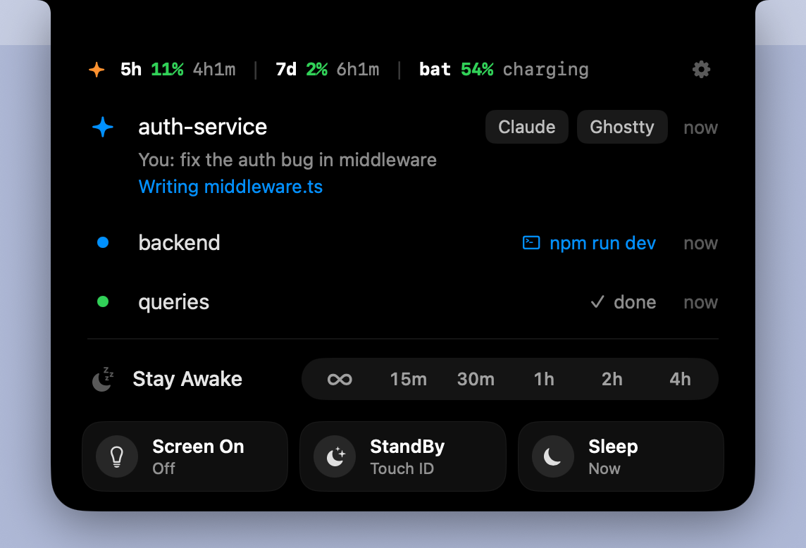
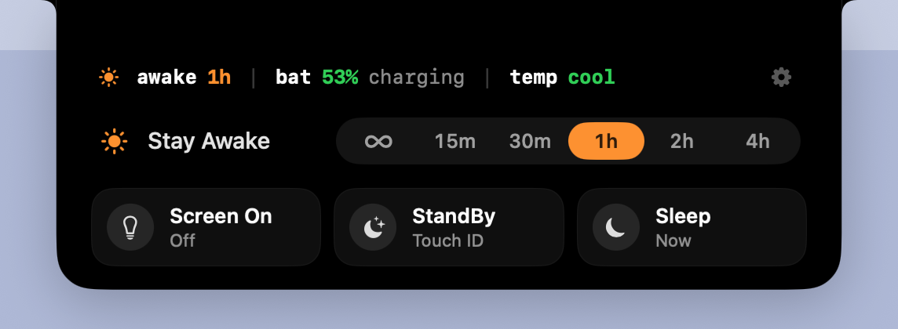
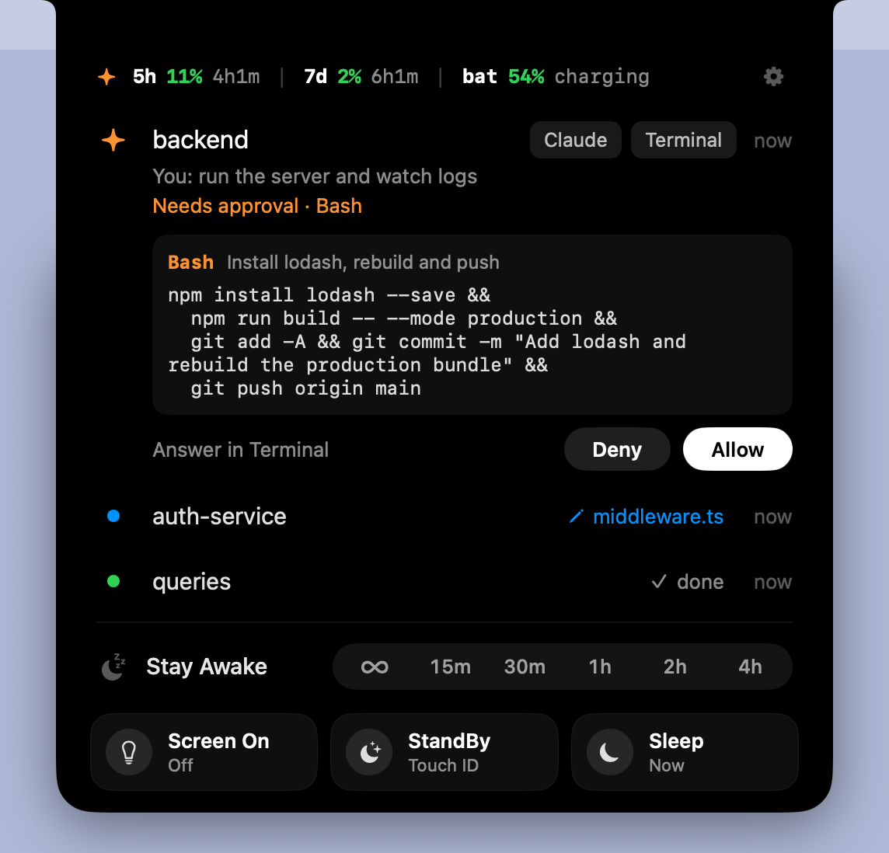
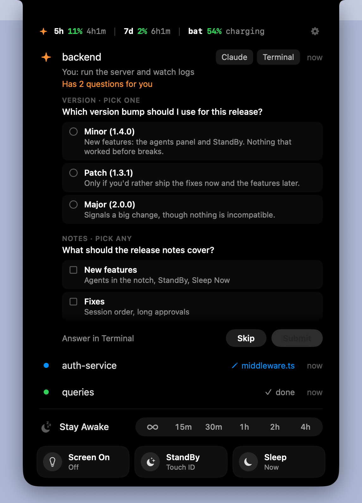
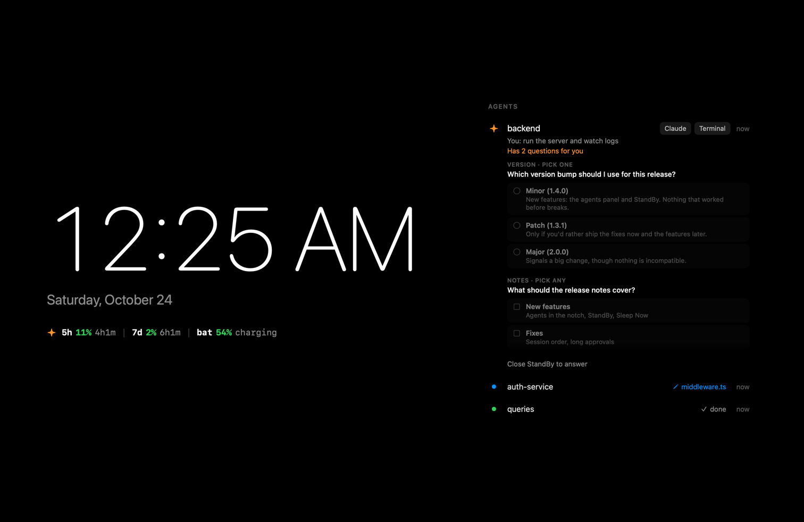

# Perch

A small native macOS app that sits in your **notch** and **menu bar** and holds quick switches
for your development setup.

The first switch, **Stay Awake**, replaces typing `sudo pmset -a disablesleep 1` / `0` by hand.
Your Mac keeps running even with the lid closed. A second switch, **Screen On**, stops the
display from dimming (like `caffeinate -d`).

> **The name will change.** "Perch" is a working name: a [notch app on the Mac App Store](https://apps.apple.com/app/perch/id6742724228)
> and a [Claude Code menu bar app on GitHub](https://github.com/ik-labs/perch) already use it. The app, its
> bundle ID and its files (`~/.perch`, `perch-hook`, `/etc/sudoers.d/perch`) will be renamed with it.

<p align="center">
  
</p>

## Install

There is no prebuilt download yet; Perch is built from source on your Mac. You need:

- macOS 14 (Sonoma) or later
- Xcode 15.3 or later, or just the Command Line Tools (`xcode-select --install`).
  Running the tests (`make test`) needs the full Xcode.

```bash
git clone https://github.com/BerkkanB/perch.git
cd perch
make install      # builds Perch.app, copies it to /Applications and opens it
```

The first build takes about a minute. To update, run `git pull` and `make install` again.

Other targets: `make run` (build and run from `./build`), `make test`, `make icon`, `make clean`.

### One-time setup

On first launch, Perch shows **Skip the password prompt → Allow…**. After you approve the macOS
admin prompt, Perch writes `/etc/sudoers.d/perch`, which allows only these two exact commands for
your user, with no password:

```
/usr/bin/pmset -a disablesleep 0
/usr/bin/pmset -a disablesleep 1
```

The file is checked with `visudo` before it is moved into place. You can view or remove it in
**Settings → Permissions**. If you skip this, Perch still works; macOS asks for your password
on every change.

## Using it

| Where | What |
| --- | --- |
| **Notch** | Rest the pointer on the notch (or click it) and a black list drops out of it: a stats line (awake time, battery, temperature), Stay Awake with a duration track, and a line for Screen On. Changes made with the shortcut or by a timer show briefly beside the camera. |
| **Menu bar** | Click for a Liquid Glass panel laid out like the system's Wi-Fi menu. Right-click (or ⌃-click) for a quick menu. ⌥-click toggles Stay Awake. |
| **Shortcut** | `⌃⌥⌘S` toggles Stay Awake from any app. Change it, or add one for any switch, in Settings. |

The duration track (`∞ 15m 30m 1h 2h 4h`) turns Stay Awake on for that long; ∞ means until you turn it off.

<p align="center">
  
</p>

### Safety

A closed MacBook that never sleeps can overheat in a bag, so Stay Awake also:

- lets the Mac sleep when running on battery below a chosen level (default 15%),
- lets the Mac sleep when it is critically hot, or hot with the lid closed,
- remembers timers across relaunches, and turns sleep back on at quit if a timer is running,
- can optionally turn sleep back on whenever Perch quits.

Changes made in the Terminal (`sudo pmset -a disablesleep …`) show up in Perch within 10 seconds.

## Coding agents

Perch can follow your Claude Code sessions in the notch, like the Dynamic Island:

- **Sessions**: the most important one written out (project, your last prompt, what it's doing
  now in blue), the others one line each with a dot: orange needs you, green done. While a
  session thinks or works, its dot becomes a small 3×3 grid with a band of light stepping
  through it, beside the camera too. Click one to bring its terminal forward.
- **Approvals**: when Claude Code asks for permission, the notch opens with the whole command
  (long ones scroll) and **Allow** / **Deny**. "Answer in Terminal" (or ignoring it) leaves the
  choice to Claude Code's own prompt.
- **Questions**: when Claude asks you something (its multiple-choice questions), the notch shows
  each question with its options, as radio buttons or checkboxes when you can pick several, and
  **Submit** sends your picks back. To type an answer of your own, use "Answer in Terminal".
- **Usage**: the top line shows Claude's 5-hour and weekly limits: `5h 11% 4h1m | 7d 2% 6h1m`.
- A message beside the camera for 3.5 s when a session finishes: "✓ my-project ··· Done 4m",
  with how long the turn took. The tick pops in and draws itself, the name and "Done" slide out
  from the camera, and a soft green glow blooms around the notch once.

<p align="center">
  
  &nbsp;
  
</p>

Turn it on in **Settings → Agents → Connect**. That adds hooks and a status line to
`~/.claude/settings.json` (your previous file is kept in `~/.perch/backups`, and any status line
you had keeps working). Sessions started after connecting show up. **Disconnect** removes only
Perch's entries.

How it works: Claude Code runs `~/.perch/bin/perch-hook` for each event; the helper forwards it
to Perch over a Unix socket in `~/.perch` that only your user can open. If Perch isn't running,
the helper exits at once and Claude Code behaves as if Perch weren't there.

## StandBy

A full-screen status screen, like StandBy on iPhone: a large clock and the date, the
`5h / 7d / battery` line, and your coding agents. Open it from the right-click menu, the menu bar
panel, a shortcut (Settings → Shortcuts), or after the Mac is idle for a while (Settings →
StandBy). While it shows, the display stays on, so the screen saver and macOS's auto-lock don't
start.

<p align="center">
  
</p>

It opens by fading the screen to black and letting the clock, then your agents, settle in out of
a soft blur (slower when it opens on its own, like the display dimming). Closing zooms it toward
you as the desktop comes back. When macOS locks or the Mac sleeps it closes at once, and with
Reduce Motion on it only cross-fades.

Closing it asks for Touch ID or your password by default, and until then app switching is
blocked and agent approvals can't be answered from it. It's a privacy screen, not a replacement
for the macOS lock: keep "Require password … Immediately" on in System Settings → Lock Screen.

## Adding a switch

Every tool is a class that conforms to `PerchModule`. The menu panel, notch controls, right-click
menu, shortcut setting and sudoers rule are all built from it.

```swift
@MainActor
@Observable
final class HiddenFilesModule: PerchModule {
    let id = "hidden-files"
    let title = "Hidden Files"
    let caption = "Shows dotfiles in Finder"
    let tint = Color.purple
    private(set) var isOn = false
    private(set) var isBusy = false

    var symbol: String { isOn ? "eye.fill" : "eye.slash" }
    var statusText: String { isOn ? "Visible in Finder" : "Hidden" }

    func refresh() async {
        let result = await Shell.run("/usr/bin/defaults", ["read", "com.apple.finder", "AppleShowAllFiles"])
        isOn = result.stdout.trimmingCharacters(in: .whitespacesAndNewlines) == "1"
    }

    func setOn(_ on: Bool, source: ToggleSource) async {
        isBusy = true
        defer { isBusy = false }
        _ = await Shell.run("/usr/bin/defaults", ["write", "com.apple.finder", "AppleShowAllFiles", "-bool", on ? "true" : "false"])
        _ = await Shell.run("/usr/bin/killall", ["Finder"])
        isOn = on
    }
}
```

Then add it to `AppModel.makeModules()`. A module that needs root lists its exact commands in
`privilegedCommands` and runs them with `context.access.run(...)`. Perch then offers to update
the sudoers rule. A module with a `timer` gets the duration track automatically.

See [docs/PLAN.md](docs/PLAN.md) for the architecture and ideas for more switches.

## Project layout

```
Sources/Perch/
  App/        entry point, AppDelegate, AppModel (module registry), icon/preview renderer
  Core/       module protocol, timers, preferences, shell, sudoers access, hotkeys, power monitor
  Modules/    StayAwake (pmset), ScreenOn (IOPMAssertion)
  UI/         DesignSystem, MenuBar (status item + glass panel), Notch (canvas + hot zone), Settings
scripts/      build-app.sh (bundle + ad-hoc signing), make-icon.sh
Tests/        pmset parsing, sudoers rule, formatting, timers
docs/         PLAN.md, README screenshots
```

### Debug helpers

```bash
swift build
.build/debug/Perch --snapshot /tmp/perch-shots   # PNGs of every window and notch state, plus open/close frames
.build/debug/Perch --demo-notch expanded         # pin the notch open (idle|badge|hud|expanded)
.build/debug/Perch --demo-menu                   # open the menu bar panel
```

The screenshots in this README come from `--snapshot`, which fills in made-up agent sessions
(add `-AppleLanguages '(en)' -AppleLocale en_US` for an English date in StandBy).

## Uninstall

Remove the permission in **Settings → Permissions → Remove…**, then run `make uninstall`.
If Perch is already gone, delete the rule with `sudo rm /etc/sudoers.d/perch`.
